# Screenshots

Fire Pro Wrestling Z with the English patch, taken in PCSX2.

## Main menu

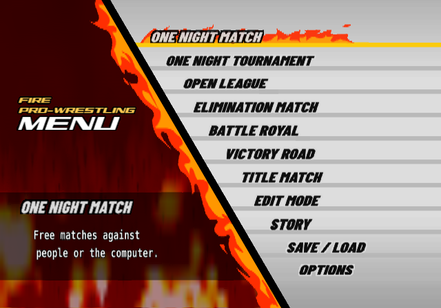

The menu labels and their subtitles, redrawn in English.

## Match rules

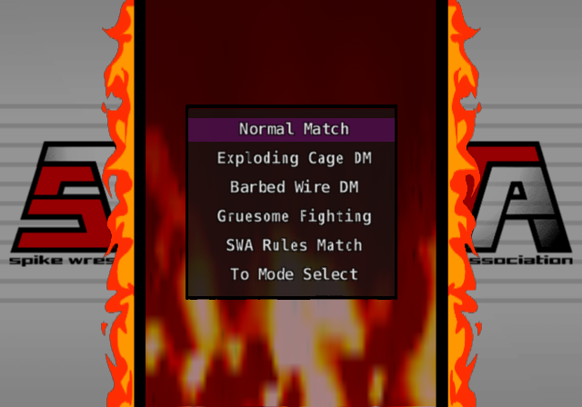

One Night Match, with the rules listed in plain English.

## Match settings

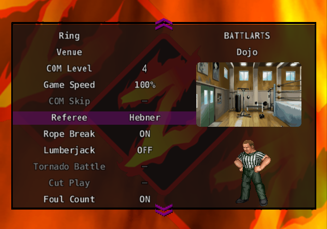

Every setting translated, here with the dojo venue from the All Unlocked patches.

## Wrestler select

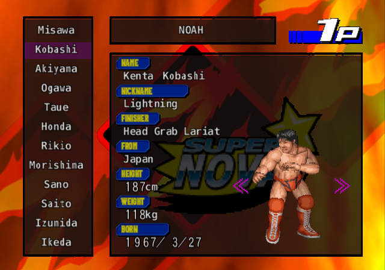

Names, nicknames, finishers and profiles, with the promotion's roster alongside.

## One Night Tournament

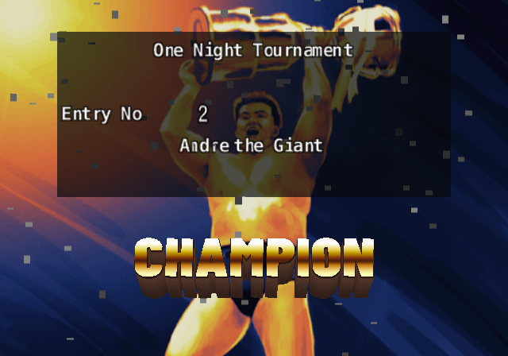

The tournament results, with the 3D result words remade in English.

## Victory Road

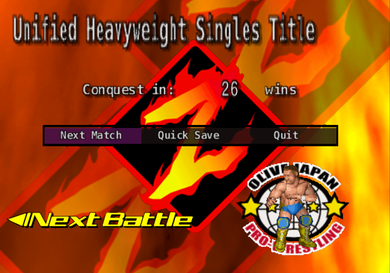

The course screen between matches, with its running count of wins.

## Belt Edit

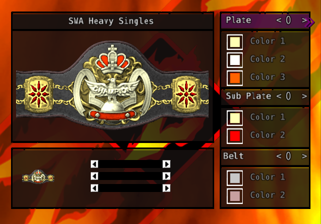

The belt maker, with every plate, colour and part labelled.

## Wrestler Edit

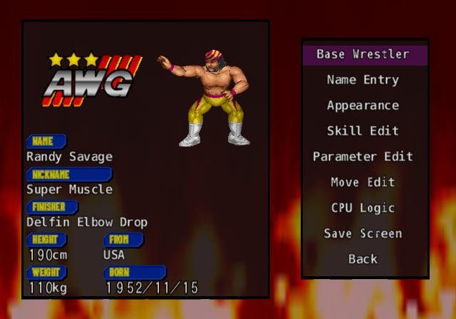

The edit menu, with a finished wrestler and his profile.

## Name entry

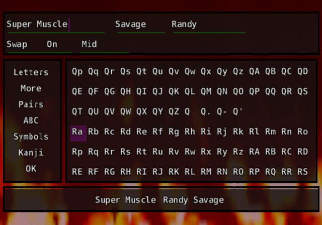

The Japanese character grid became an English keyboard.

## Costume edit

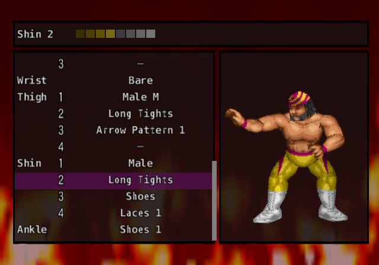

Every body part and costume piece is named.

## Voices

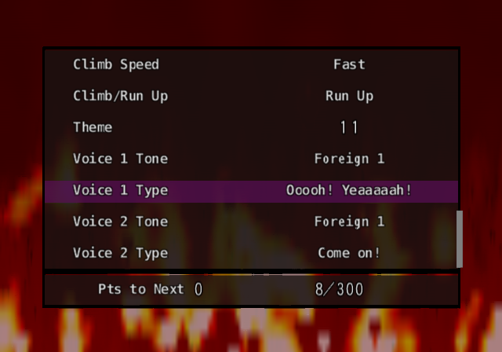

The wrestler's shouts and move speeds, translated line by line.

## Move Edit

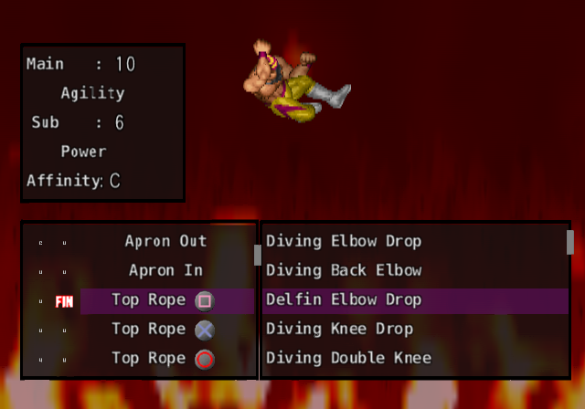

Move names fill the lists, and the move slots are labelled.

## CPU Logic

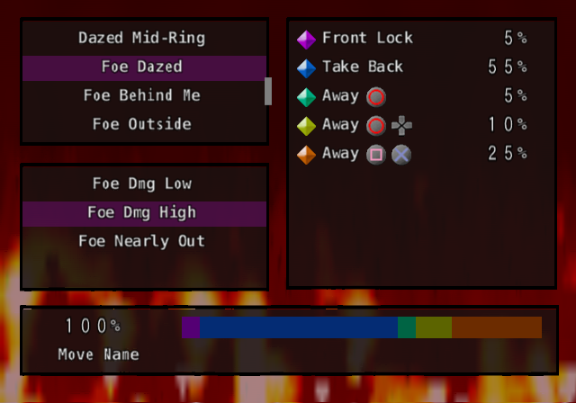

The situations and actions that set how the computer fights.

## Costume select

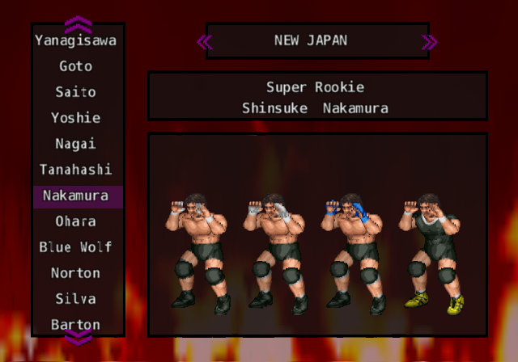

A wrestler's costumes side by side, with his promotion and nickname in English.

## Story select

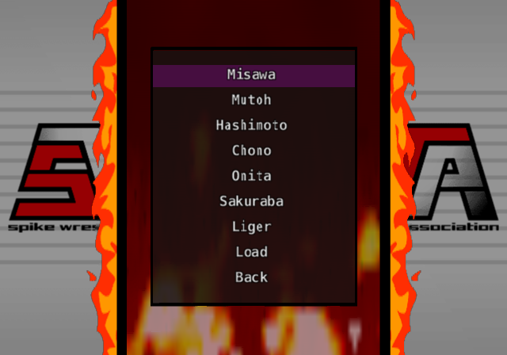

All seven scenarios, with the hidden seventh (Liger) in the All Unlocked patches.

## Story mode

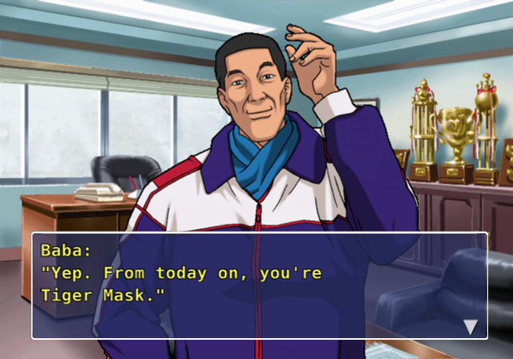

Over 12,000 pages of story text, with English drawn into the game's own text window.
